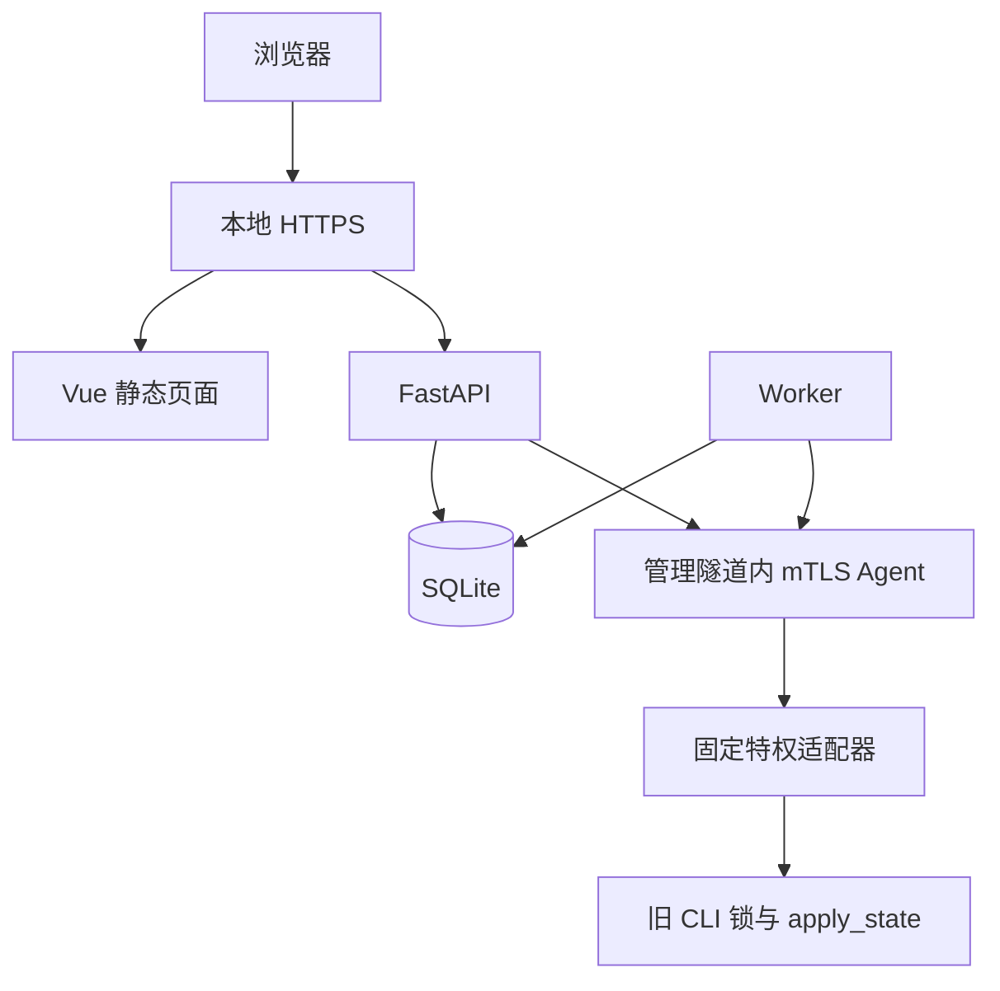
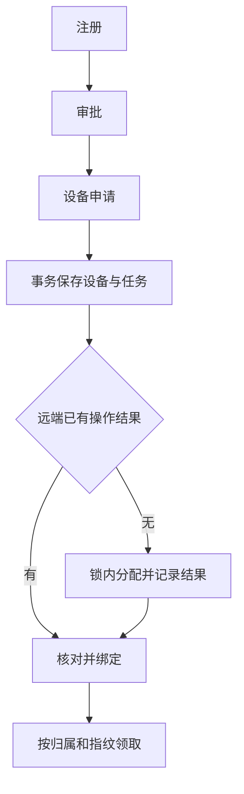

# 部署与事务边界

远端操作记录与 Peer 在同一份旧状态文件内提交。超时后按请求 UUID 查询。本地保留未完成任务，Worker 重启可继续。外部 Peer 默认只读；接管时绑定设备 UUID 并校验指纹。

## 状态机与故障处理

|事件|本地状态与恢复方式|
|---|---|
|申请被接受|同一事务写入 pending 设备和任务。同一用户的 Idempotency-Key 对应固定任务号；不同参数重用同一键会被拒绝。|
|VPS 已提交、网络超时|任务仍 pending，轮询退避至最多 300 秒；先查询 results，校验请求签名、动作和设备，再绑定并提交 done。|
|本地写入或进程中断|SQLite 回滚未提交事务，下一次 Worker 从原任务恢复；远端账本保留已完成操作。|
|远端明确拒绝|任务 failed、设备 error，在日志查看错误并核对后重试。|
|旧系统禁用或轮换|对账刷新 enabled、disabled、fingerprint 和采样；即使在下次采样前，锁内导出也会拒绝旧指纹或禁用的 Peer。|
|旧系统删除|设备 missing，用户不能领取。管理员回收时实时核实该 VPS 已无该设备绑定，再释放本地配额。|
|用户停用|立即撤销本地会话，已启用 Peer 排队停用；对账会再次检查账号状态。|
|VPS 不可达|节点健康状态及采样时间可供查看，任务保留；管理员可以手动对账。|
|恢复网页备份|撤销所有会话，将原 pending 任务暂停为 held，管理员核对后重试。|

本地采用单个 FastAPI 应用、独立 Worker 和集中的数据库模块，避免为每个表增加仅转发调用的层。部署用同一入口提供静态前端和 API。VPS 的网络服务以普通用户运行，特权适配器仅在请求期间执行。
